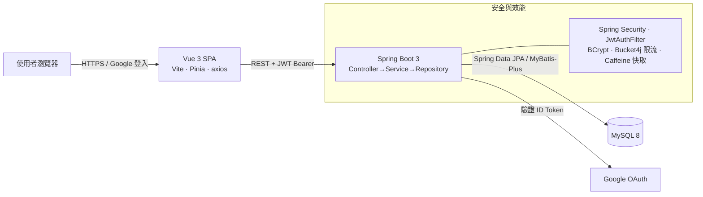

# Voyago — 歐洲自助遊預訂平台

[](https://github.com/kensong0518/voyago-fullstack/actions/workflows/ci.yml)
[](https://voyago-backend-c8fd.onrender.com)


Voyago 是一個前後端分離的旅遊行程預訂平台：Vue 3 單頁前端透過 axios 呼叫 Spring Boot REST API，資料存於 MySQL。除了基本 CRUD，系統也處理了幾個正式產品常見但容易被忽略的需求——帳密登入之外整合 Google 登入、密碼以 BCrypt 雜湊、登入端點做限流、熱門查詢加快取、並搭配單元測試與 CI。

線上示範：<https://voyago-backend-c8fd.onrender.com>

> 線上站台是**完整三層架構**，部署成**單一網址**：Render 上的一個 Spring Boot 服務同時提供 Vue 網頁與 REST API，資料存在 TiDB Cloud（MySQL 相容）。註冊、下訂、收藏都會真的寫進資料庫，換裝置登入資料還在；推送到 GitHub `main` 就自動重新部署。
>
> 後端用的是免費方案，閒置 15 分鐘會休眠，**第一次打開可能要等 30–60 秒**喚醒，之後就正常速度。
>
> | 層 | 線上位址 |
> | --- | --- |
> | 網站（前台／後台） | <https://voyago-backend-c8fd.onrender.com>（後台：`/admin`） |
> | API | <https://voyago-backend-c8fd.onrender.com/api/routes>（健康檢查：`/actuator/health`） |
> | 資料庫 | TiDB Cloud Starter（東京），只接受 TLS 連線 |

```
瀏覽器 (Vue 3 SPA)  ──axios / JWT──▶  Spring Boot REST API  ──JPA / MyBatis-Plus──▶  MySQL 8
```



---

## 設計重點

系統的重點不在功能數量，而是每個技術決定背後有沒有明確理由：

- 登入不是只有帳密，還要能擋暴力破解、能接第三方、能水平擴展 → JWT + BCrypt + Bucket4j 限流 + Google ID Token 後端驗證。
- 查詢不是能跑就好，列表頁不能一打開就噴出十幾條 SQL → LAZY + fetch join 解 N+1，熱門資料上 Caffeine 快取。
- 權限不能靠前端藏按鈕 → 後端用 `@PreAuthorize` 強制，STAFF 專屬端點前端就算被繞過也擋得住。
- 前端示範模式不應依賴後端是否在線 → 內建 mock fallback，同一套 UI 與 API 介面，離線也能展示。

---

## 技術棧

| 層 | 用了什麼 |
| --- | --- |
| 前端 | Vue 3（Composition API）、Vite、Vue Router、Pinia、axios、Tailwind CSS |
| 後端 | Spring Boot 3、Spring Security、Spring Data JPA、MyBatis-Plus、JWT（jjwt）、Google API Client、Bucket4j、Caffeine、Actuator、WebSocket（STOMP，即時客服聊天）、Spring Mail（非同步訂單確認信）、H2（測試用） |
| 資料庫 | MySQL 8（utf8mb4、InnoDB、外鍵 + 複合索引） |
| 驗證 | JWT Bearer Token、BCrypt 密碼雜湊、Google ID Token 後端驗證 |
| 測試 | JUnit 5、Mockito、Maven Surefire |
| 部署 | Docker（前後端同一個映像）/ docker-compose、Nginx、GitHub Actions、Render（`render.yaml`）、TiDB Cloud |
| API 文件 | springdoc-openapi（Swagger UI） |

同一個專案裡並行 Spring Data JPA 和 MyBatis-Plus 兩套 ORM，是刻意的技術選型比較（理由見下方「設計取捨」），不是堆疊技術清單。

---

## 功能

**AI 行程顧問**（首頁最上方，免登入）：用一句話描述需求（「兩人蜜月、每人 8 萬、想看海」），Gemini 只能從資料庫裡的真實行程挑選並說明理由。防亂編用三層：行程清單當資料給模型、回傳格式把行程代稱限定在清單內（JSON Schema enum）、後端再逐筆比對資料庫；價格天數一律用資料庫的值。每位訪客每天 10 次、全站每天 300 次，訪客以 Cloudflare 的 `CF-Connecting-IP` 識別（Render 的 `X-Forwarded-For` 可被偽造，實測過）。

一般會員能做的事：註冊登入（帳密或 Google）、搜尋與篩選行程（關鍵字、標籤、多種排序、分頁）、看行程詳情（圖庫、每日安排、依標籤重疊與同國家計分的「相似行程推薦」）、收藏行程（後端持久化，換裝置也看得到，連不上後端時退回本機暫存）、下訂單（選日期人數、自動算總價、過去的日期會被擋）、模擬結帳（可輸入優惠碼，折抵金額由後端計算；轉已付款後背景寄送確認信）、**評價行程**（只有付過款的會員能寫，每人一則可修改；行程的平均分數由評價表重新計算，沒有評價就顯示「尚無評價」，不放假評價）、**行程比較**（最多 3 個並排，標出最便宜、每天最划算、評價最高）、手機版的篩選改成從底部滑出的抽屜、在會員中心管訂單和個資、刪帳號要雙重確認，還有即時客服對話（WebSocket 推播，連不上會自動退回原本的 REST 輪詢）。

管理員（STAFF）登入後直接進**後台 `/admin`**，一般會員則進前台的會員中心。後台最上方是儀表板統計卡片（總會員數、本月新增、訂單狀態分布、總營收），下面分六個分頁：

- **營收報表**：近 7／30／90 天的每日已付款營收、每日新訂單（純 SVG 長條圖，可切換成表格）、熱賣行程排行；一鍵匯出訂單或會員 **CSV**（UTF-8 BOM，Excel 直接開不亂碼；以 `= + - @` 開頭的欄位會加單引號，防公式注入）。
- **行程管理**：新增 / 編輯 / 刪除行程（含欄位驗證、封面圖預覽）。改完會清掉前台的 Caffeine 快取，前台下一次請求就看到新內容；已經有訂單的行程不能刪，避免交易紀錄被連帶消失。
- **訂單管理**：看所有會員的訂單（含下訂人），依狀態篩選、直接改付款狀態，儀表板數字跟著更新。
- **會員管理**：用姓名 / Email / 電話搜尋會員、分頁瀏覽、新增會員（能指定角色、有密碼強度規則）、刪除會員。後端會擋住「刪掉自己」，避免把管理員全鎖死。
- **優惠碼**：新增／編輯／停用優惠碼（百分比或固定金額、最低消費、使用上限、到期時間）。使用次數用條件式 `UPDATE … WHERE used_count < max_uses` 原子遞增，同時搶最後一張也不會超賣；每位會員每個碼限用一次，取消訂單會歸還次數；用過的碼只能停用不能刪。
- **操作紀錄**：後台的新增、修改、刪除、匯出都會記下操作者、時間與內容（例如「PENDING → CONFIRMED」），只能看不能改。

**誰是管理員**由部署環境變數 `ADMIN_EMAILS` 決定：名單內的帳號用 **Google 登入**時自動成為 STAFF。只認 Google 登入是刻意的——帳密註冊不驗證 Email 所有權，如果也認帳密，任何人搶先用管理員的 Email 註冊就能拿到後台；所以名單內的 Email 也禁止走帳密註冊。正式站台不會建立密碼寫在本文件裡的示範客服帳號（`SEED_DEMO_STAFF=false`）。

工程上幾個細節：前端的示範模式（`VITE_DEMO_ONLY`）會在頁面上下顯示聲明橫幅、axios 攔截器統一處理 401（清掉 token 導回登入）、後端開 `/actuator/health` 給 Docker 和雲端平台探活。

---

## 專案結構

```
voyago-fullstack/
├── 前端/                Vue 3 + Vite 單頁應用
│   ├── src/views/       各頁面（首頁 / 行程 / 詳情 / 登入 / 會員中心 / 客服）
│   ├── src/components/  元件（NavBar、RouteCard、DemoBanner…）
│   ├── src/api/         axios 封裝（攔截器、示範模式 fallback）
│   ├── src/stores/      Pinia（auth 狀態、isStaff getter）
│   ├── Dockerfile       多階段建置 → Nginx 服務靜態檔
│   └── nginx.conf       gzip、安全標頭、/api 反代、資產快取
├── 後端/                Spring Boot REST API
│   ├── src/main/java/com/voyago/
│   │   ├── entity/      JPA 實體（Member / Route / Booking / Message）
│   │   ├── repository/  Spring Data JPA + Criteria DAO / MyBatis-Plus Mapper
│   │   ├── service/     商業邏輯（介面 + Impl、交易邊界、快取）
│   │   ├── controller/  REST API（進出都用 DTO，不外洩 Entity）
│   │   ├── security/    JwtAuthFilter、AuthRateLimitFilter（Bucket4j）
│   │   ├── config/      SecurityConfig、CacheConfig、全域例外處理
│   │   └── dto/         請求 / 回應物件（Bean Validation）
│   └── src/test/java/   JUnit 5 + Mockito 單元測試、MockMvc 整合測試
├── 資料庫/
│   ├── 01_schema.sql    建庫建表（外鍵、複合索引、utf8mb4）
│   └── 02_seed.sql      10 條歐洲行程 + 體驗帳號 + 示範訂單
├── Dockerfile           整站映像：先建前端再打包進 Spring Boot jar（多階段、依賴層快取、JRE Alpine、non-root）
├── docker-compose.yml   一鍵起三層（volume、初始化 SQL、健康檢查鏈）
├── render.yaml          Render Blueprint：後端部署設定
├── netlify.toml         舊 Netlify 網址：全部 301 轉址到正式站（舊連結不失效）
├── scripts/
│   └── build_netlify_drop.py  依 netlify.toml 打包舊網址的轉址站，給 Netlify 手動上傳用
└── DEPLOY.md            雲端部署逐步指南（TiDB Cloud → Render）
```

四張表以外鍵串在一起：`member`、`route`、`booking`（連 member 和 route）、`message`（連 member）。

---

## 快速開始

需求：JDK 17+、Maven 3.8+（或用內附 `mvnw`）、Node.js 18+、MySQL 8。

**最快：Docker 一鍵起**

```bash
cp .env.example .env     # 填 MYSQL_ROOT_PASSWORD、JWT_SECRET（Google ID 選填）
docker compose up --build
# 前端  http://localhost
# 後端  http://localhost:8080（Swagger: /swagger-ui.html）
# 健康  http://localhost:8080/actuator/health
```

MySQL 第一次啟動會自動跑 `資料庫/` 裡的建表和種子 SQL，資料用 volume 存著。

**三層各自起**

```bash
# 資料庫
mysql -u root -p < 資料庫/01_schema.sql
mysql -u root -p < 資料庫/02_seed.sql

# 後端（:8080），需先設定環境變數
cd 後端
export DB_USER=root DB_PASSWORD=你的密碼 JWT_SECRET=至少32位元組的隨機字串   # Windows 用 set
mvn spring-boot:run

# 前端（:5173，已代理 /api → 8080 免處理 CORS）
cd 前端 && npm install && npm run dev
```

**只跑前端（不需後端和 DB）**

```bash
cd 前端
VITE_DEMO_ONLY=true npm run dev
```

這模式所有 API 都改讀內建假資料（localStorage 存），行為跟線上 Demo 一樣，純看 UI 最方便。

---

## 體驗帳號

| 角色 | Email | 密碼 | 能做什麼 |
| --- | --- | --- | --- |
| 一般會員 | `demo@voyago.com` | `password123` | 預訂、訂單、客服、編輯資料（本機與線上都有） |
| 客服人員 | `staff@voyago.com` | `staff1234` | 以上全部，再加後台（**只在本機**；線上站台的後台改由 `ADMIN_EMAILS` 裡的 Google 帳號登入） |

登入頁已經預填會員帳號，點一下就能進。

要開 Google 登入的話：到 Google Cloud Console 建一個 OAuth 用戶端 ID，把 `http://localhost:5173` 加進授權來源，然後前端 `.env` 填 `VITE_GOOGLE_CLIENT_ID`、後端環境變數填 `GOOGLE_CLIENT_ID`，重啟就會出現按鈕。沒設定時按鈕自動隱藏，不影響其他功能。

---

## API 一覽

後端起來後可開 Swagger UI（`/swagger-ui.html`）互動試打。`/api/auth/**` 受 Bucket4j 限流，每個 IP 每分鐘 5 次。

| 方法 | 路徑 | 說明 | 權限 |
| --- | --- | --- | --- |
| POST | `/api/auth/register` | 註冊（密碼 8+ 含英數，回 JWT） | 公開 |
| POST | `/api/auth/login` | 帳密登入 | 公開 |
| POST | `/api/auth/google` | Google 登入（後端驗 ID Token） | 公開 |
| GET | `/api/auth/me` | 取得當前會員 | 登入 |
| GET | `/api/routes?q=&tag=&sort=` | 行程列表（走快取） | 公開 |
| GET | `/api/routes/page?page=&size=` | 分頁查詢 | 公開 |
| GET | `/api/routes/{slug}` | 單一行程 | 公開 |
| GET | `/api/routes/{slug}/similar?limit=` | 相似行程推薦（標籤重疊 + 同國家計分） | 公開 |
| GET | `/api/bookings` | 我的訂單（fetch join 避 N+1） | 登入 |
| POST | `/api/bookings` | 建立訂單（過去日期 / 超量擋下） | 登入 |
| DELETE | `/api/bookings/{id}` | 取消訂單 | 本人 |
| GET / POST | `/api/chat` | 客服訊息讀取 / 送出（REST，WS 連不上時的 fallback） | 登入 |
| WS | `/ws-chat`（STOMP，`?token=` 帶 JWT） | 即時客服聊天：訂閱 `/user/queue/chat`、送到 `/app/chat.send` | 登入 |
| POST | `/api/bookings/{id}/pay` | 模擬結帳（轉 CONFIRMED，觸發非同步確認信） | 本人 |
| GET | `/api/favorites` | 我的收藏（含行程資料） | 登入 |
| POST / DELETE | `/api/favorites/{routeId}` | 收藏 / 取消收藏（冪等） | 登入 |
| PUT / DELETE | `/api/members/me` | 編輯 / 刪除自己 | 登入 |
| GET | `/api/members?q=&page=&size=` | 會員搜尋分頁 | STAFF |
| POST | `/api/members` | 新增會員 | STAFF |
| DELETE | `/api/members/{id}` | 刪除會員（不能刪自己） | STAFF |
| GET | `/api/admin/stats` | 後台儀表板統計（會員數、訂單狀態分布、總營收） | STAFF |
| POST | `/api/admin/routes` | 新增行程（網址代稱不可重複） | STAFF |
| PUT / DELETE | `/api/admin/routes/{id}` | 編輯 / 刪除行程（有訂單的行程不能刪） | STAFF |
| GET | `/api/admin/bookings?status=&page=&size=` | 所有會員的訂單（含下訂人），可依狀態篩選 | STAFF |
| PUT | `/api/admin/bookings/{id}/status` | 調整訂單狀態 | STAFF |
| GET | `/api/admin/reports?days=` | 營收報表（每日訂單、已付款營收、熱賣行程） | STAFF |
| GET | `/api/admin/export/bookings.csv`、`members.csv` | CSV 匯出（會記入操作紀錄） | STAFF |
| GET | `/api/admin/audit?page=&size=` | 操作紀錄 | STAFF |
| GET / POST / PUT / DELETE | `/api/admin/coupons[/{id}]` | 優惠碼管理 | STAFF |
| GET | `/api/ai/status`、POST `/api/ai/advisor` | AI 行程顧問（每位訪客每天 10 次） | 公開 |
| GET | `/api/routes/{slug}/reviews` | 行程評價（平均、分佈、最新評價，作者名稱遮蔽） | 公開 |
| GET | `/api/routes/{slug}/reviews/eligibility` | 我能不能評價（有已付款訂單才行） | 登入 |
| PUT / DELETE | `/api/routes/{slug}/reviews/mine` | 寫／改／刪我的評價 | 付款會員 |
| GET | `/api/reviews/latest` | 首頁「旅人怎麼說」：全站最新好評 | 公開 |
| PUT / DELETE | `/api/bookings/{id}/coupon` | 結帳時套用／移除優惠碼（只限待付款訂單） | 本人 |
| GET | `/actuator/health` | 健康檢查（只開 health/info） | 公開 |

---

## 資料庫設計

```mermaid
erDiagram
    MEMBER ||--o{ BOOKING : "下訂"
    ROUTE  ||--o{ BOOKING : "被預訂"
    MEMBER ||--o{ MESSAGE : "對話"
    MEMBER ||--o{ FAVORITE : "收藏"
    ROUTE  ||--o{ FAVORITE : "被收藏"

    MEMBER {
        bigint id PK
        varchar email UK "唯一索引"
        varchar password "BCrypt 雜湊, Google 用戶可為 NULL"
        varchar role "MEMBER / STAFF"
        varchar provider "LOCAL / GOOGLE"
    }
    ROUTE {
        bigint id PK
        varchar slug UK "SEO 友善網址"
        int price
        decimal rating
        boolean featured
    }
    BOOKING {
        bigint id PK
        bigint member_id FK "ON DELETE RESTRICT"
        bigint route_id FK "ON DELETE RESTRICT"
        date travel_date
        varchar status "PENDING / CONFIRMED / CANCELLED"
    }
    MESSAGE {
        bigint id PK
        bigint member_id FK "ON DELETE CASCADE"
        varchar sender "MEMBER / STAFF"
    }
    FAVORITE {
        bigint id PK
        bigint member_id FK "ON DELETE CASCADE"
        bigint route_id FK "ON DELETE CASCADE"
        UK "(member_id, route_id) 防重複收藏"
    }
```

索引是照實際查詢加的，不是每欄都塞：

| 表 | 索引 | 服務哪個查詢 |
| --- | --- | --- |
| route | `(featured, reviews)` 複合 | 首頁精選排序 |
| route | `price` / `rating` / `days` / `country` | 列表排序與篩選 |
| booking | `(member_id, created_at DESC)` 複合 | 會員中心訂單列表 |
| booking | `travel_date` / `status` | 報表與狀態篩選 |
| message | `(member_id, created_at)` 複合 | 客服對話依時序載入 |

---

## 安全性

目標是「資料不被偷、帳號不被冒用」。依攻擊情境整理：

| 情境 | 防護 |
| --- | --- |
| 猜密碼 | 每個 IP 每分鐘 5 次登入（`AuthRateLimitFilter`）；**同一帳號 15 分鐘內錯 5 次鎖 15 分鐘**（`LoginAttemptService`，擋換 IP 猜同一帳號）。帳號不存在與密碼錯誤回同一句話，鎖定也不分是否為會員，無法藉此探測哪些 Email 已註冊 |
| token 被偷走 | 登入有效期 1 天；每個 token 帶「憑證版本」，**會員可按「登出所有裝置」讓所有舊 token 立即失效**（`token_version`，JWT 本身無法撤銷，靠這個補上） |
| 帳號刪除、權限調整後舊 token 還能用 | 每個請求都對資料庫確認帳號存在、版本相符、token 的 Email 與帳號一致，**角色以資料庫為準、不信 token 內容**（`SessionValidator`，15 秒小快取，變更時主動清除）；WebSocket 握手同樣檢查 |
| 冒用別人的 Email | Google 登入只收 Google 驗證過的 Email；有人先用別人的 Email 帳密註冊，真正擁有者用 Google 登入時，**舊密碼作廢、舊 token 全部失效**，帳號回到擁有者手上；管理員 Email 禁止帳密註冊 |
| 一般會員打後台 API | `@PreAuthorize("hasRole('STAFF')")` 由後端強制；嘗試會記成資安事件 |
| 大量爬資料、狂打 API | 全站每 IP 每分鐘 120 次、寫入 30 次（`ApiRateLimitFilter`）；AI 顧問另有每日額度；訪客 IP 用 Cloudflare 的 `CF-Connecting-IP`（`X-Forwarded-For` 可偽造，實測過） |
| XSS 偷 token、點擊劫持 | CSP 只允許本站與 Google 登入／字型的程式碼、`frame-ancestors 'none'`、HSTS、`nosniff`、`Referrer-Policy`、`Permissions-Policy`（`SecurityConfig`） |
| 事後追查 | 登入成功／失敗／鎖定、權限不足、登出所有裝置、帳號收回都寫入操作紀錄（含來源 IP），後台可篩選「資安事件」 |
| 資訊外洩 | 正式站關閉 Swagger API 文件；Actuator 只開 health/info；錯誤不回 stack trace；API 只回 DTO，不含密碼雜湊；CSV 匯出防公式注入、`Cache-Control: no-store` |

其他基礎：BCrypt 密碼雜湊（8+ 字元含英數，前後端都驗）、Google ID Token 由後端驗簽章與 audience、`JWT_SECRET` 少於 32 字元直接拒絕啟動、所有密鑰走環境變數。

---

## 效能

- 快取：行程讀取用 Caffeine（500 筆、5 分 TTL）配 Spring Cache，熱門列表不重複打 DB。TTL 取 5 分鐘是因為行程資料變動不頻繁，是「即時性 vs DB 壓力」的折衷；之後如果加寫入 API，配 `@CacheEvict` 就能主動失效。
- N+1：`Booking.route` 改 LAZY，列表查詢用 Criteria `fetch join` 一次帶出關聯。
- 交易邊界：Service 預設 `@Transactional(readOnly = true)`，寫入方法各自開寫交易。
- 防失控查詢：客服訊息設 hard limit 500 筆。
- 前端打包：Vite `manualChunks` 把 vue 生態和 axios 拆開，配 Nginx `/assets/*` 一年 immutable 快取，改版只重抓變動的 chunk。
- 圖片：列表圖 `loading="lazy"`、首屏主圖 `fetchpriority="high"`。
- Docker：後端 Dockerfile 拆 Maven 依賴層，rebuild 從約 2 分鐘降到約 20 秒；JRE Alpine 縮小映像。

---

## 測試與 CI

```bash
cd 後端 && mvn test    # JUnit 5 + Mockito
```

| 測試類 | 涵蓋 |
| --- | --- |
| `JwtUtilTest` | JWT 簽發驗證、過期 / 被竄改要拒絕 |
| `RouteServiceTest` | 列表查詢、排序、slug 查詢、分頁總頁數、相似行程推薦的計分排序 |
| `BookingServiceTest` | 訂單金額計算、日期驗證（以固定 `Clock` 注入，不受執行當下日期影響）、權限檢查、付款成功會觸發一次（且僅一次）確認信 |
| `FavoriteServiceTest` | 新增收藏、重複收藏的冪等處理、取消收藏 |
| `AdminStatsServiceTest` | 後台統計彙總邏輯，含「本月新增會員」的時間邊界（固定 `Clock`） |
| `ApiPermissionIntegrationTest` | Controller 層整合測試，用 MockMvc + H2（`test` profile）跑完整的 Spring Security filter chain，驗證權限矩陣：公開端點免登入、一般端點（訂單、收藏）需登入、後台端點（會員管理、統計）需 `STAFF` 角色；一般會員打後台端點要回 403（不是 500） |
| `AdminManageIntegrationTest` | 後台行程 / 訂單管理：權限、代稱不可重複、有訂單的行程不能刪、輸入驗證，以及「後台改完、前台下一個請求就看到新資料」（驗證快取確實被清掉） |
| `AuthServiceAdminTest` | 誰能進後台：名單內且經 Google 驗證 Email 的帳號才是 STAFF（大小寫不敏感），未驗證 Email 或名單外一律是一般會員，名單內的 Email 不能走帳密註冊 |
| `HealthEndpointIntegrationTest` | 沒有郵件伺服器時 `/actuator/health` 仍是 UP——寄信是選用功能，不能讓雲端平台判定整個服務失敗 |

CI 走 GitHub Actions：每次 push / PR 自動跑後端 `mvn verify`、前端 `npm ci && npm run build`，再用跟 Render **完全相同的 Dockerfile 與 build context** 建一次後端映像，部署設定壞掉會在 CI 先被抓到。同分支重複觸發會自動取消舊任務。

---

## 雲端部署

兩個免費平台就能把整包掛上去，部署成**一個網址**：

| 元件 | 平台 | 設定檔 |
| --- | --- | --- |
| 網頁＋API | Render（Blueprint，推 `main` 自動部署） | `render.yaml` + 根目錄 `Dockerfile`：先 `vite build`，產物放進 Spring Boot 的 `classpath:/static/` 一起打包；`SpaWebConfig` 讓 `/tours/...`、`/admin` 這類前端路由回 `index.html`，`/api`、`/actuator` 找不到則照常 404 |
| 資料庫 | TiDB Cloud Starter（MySQL 相容、TLS） | 在 SQL Editor 執行 `資料庫/01_schema.sql`；行程與示範會員由後端第一次啟動時自動寫入 |

前端的正式環境設定在 `前端/.env.production`（全是公開值）：`VITE_DEMO_ONLY=false`、`VITE_MOCK_FALLBACK=false`。後者很重要——後端慢或出錯時，前端**不准**偷偷改用內建假資料，否則看起來有串接其實沒有。API 與 WebSocket 都走同源，不需要 CORS 反代。

為什麼選單一網址，而不是前端放 CDN、後端分開：作品集只有一個連結最好分享，也只有一條部署管線（推 GitHub 就更新）；代價是免費方案休眠時整個網站要等喚醒，而不只是資料。舊的 Netlify 網址保留成 301 轉址，避免已經分享出去的連結失效。

逐步指南見 [DEPLOY.md](DEPLOY.md)。

部署過程踩到、已經從根源修掉的幾個坑（都有對應的測試或 CI 檢查）：

- **Render 不接受非 ASCII 路徑**：`./後端/Dockerfile` 被 Blueprint 判定無效 → Dockerfile 放在 repo 根目錄，docker-compose 也用同一份，CI 用相同設定建映像並檢查 jar 裡確實有前端網頁。
- **沒有郵件伺服器時健康檢查永遠 DOWN**：Spring 的 mail health indicator 讓 `/actuator/health` 回 503，Render 判定部署失敗 → 關掉 mail 的健康檢查（寄信是選用功能），資料庫檢查保留。
- **免費方案啟動逾時**：G1 + 完整 JIT 的背景執行緒在極少的 CPU 上跟啟動搶資源 → 正式環境用 SerialGC + C1，並且不讓 Hibernate 每次啟動跨區掃描 schema（`ddl-auto=none`，結構由 SQL 檔管理）。
- **Netlify 不會在 redirect 規則裡代換環境變數**：原本 `${BACKEND_ORIGIN}` 的反代寫法實際上不會生效。改成單一網址部署後已經不需要反代。

---

## 幾個設計取捨

**為什麼前後端分離。** 前端可以獨立丟到 CDN，後端純 API 能水平擴展，兩邊用 JSON 合約溝通，開發時能分頭做。

**為什麼 JWT 不用 Session。** 無狀態，後端加節點不用共享 Session store；Token 放 `Authorization: Bearer`，順便躲掉 CSRF。

**為什麼同時用兩套 ORM。** Booking / Message / Member 用 JPA + Criteria API（型別安全的動態查詢、fetch join）；Route 用 MyBatis-Plus（`LambdaQueryWrapper` + 分頁外掛）。JPA 的關聯映射省事但複雜查詢容易失控，MyBatis-Plus 對 SQL 掌控度高但關聯要自己接；兩者並存是刻意比較，正式產品會收斂成一套。

**為什麼做示範模式，又為什麼線上把它關掉。** 示範模式讓前端不靠後端也能完整展示，適合只要看 UI 的場合。但正式串接後端的站台一定要關掉「出錯就改用假資料」：否則後端一慢，登入和下單就會悄悄變成存在瀏覽器裡的假資料，畫面看起來正常、資料卻沒進資料庫。所以這兩件事拆成兩個開關：`VITE_DEMO_ONLY`（整站離線展示）與 `VITE_MOCK_FALLBACK`（後端出錯時要不要降級）。

**限流為什麼放 Filter 不放 Controller。** 在進 Spring MVC 之前就擋掉超量請求，省下反序列化和後面一整串業務處理的成本。

---

## 已知限制與下一步

有些地方是刻意收斂範圍，不是沒想到：

- 客服聊天走 STOMP over WebSocket 即時推播（`/ws-chat`，JWT 走 query string 驗證）。線上是同源部署，直接連；若改回前後端分開部署，需設定 `VITE_WS_BASE` 直連後端 `wss://`（CDN 的反代不一定支援 WebSocket upgrade）。
- 沒有金流。訂單只到「建立 / 取消 / 標記付款」，真的接金流要再處理狀態機和對帳。
- 確認信：Render 免費方案封鎖對外 SMTP，雲端改由 Google Apps Script 用站長的 Gmail 寄出（`scripts/mail-relay/`，後端只送訂單欄位、信件內容在 Apps Script 端組成，網址外流也不能寄任意內容）。兩者都沒設定時安全跳過，不影響付款流程。
- 資料庫結構升級：正式站 `ddl-auto=none`，結構變更寫成 `後端/src/main/resources/db/migration/V{n}__*.sql`，啟動時由 `SchemaMigrator` 依版本執行一次並記錄（同 Flyway 的做法；TiDB 需要 Flyway 10 的獨立模組，與目前 Spring Boot 版本搭配不保證相容，所以自己實作這一小段）。
- Controller 層已補 `MockMvc` + H2 的權限矩陣整合測試，但還沒有前端 E2E。
- 圖片走外部連結加 `onerror` 備援，正式上線應該換成自己的物件儲存 + CDN。
- 示範模式（`VITE_DEMO_ONLY=true`）的假資料存在 localStorage，換裝置或清快取就沒了，這是刻意的；後台的行程 / 訂單管理在示範模式下不能用，因為沒有可寫入的資料庫。
- 免費方案的後端閒置會休眠，第一次請求要等喚醒。要隨時秒開就得升級付費方案。
- 免費方案的網址是 Render 依服務名稱配的（`voyago-backend-c8fd.onrender.com`）；要更好記的網址可以綁自己的網域。

---

## 授權

MIT License，見 [LICENSE](LICENSE)。

線上站台為示範性質，非真實旅遊預訂服務。
